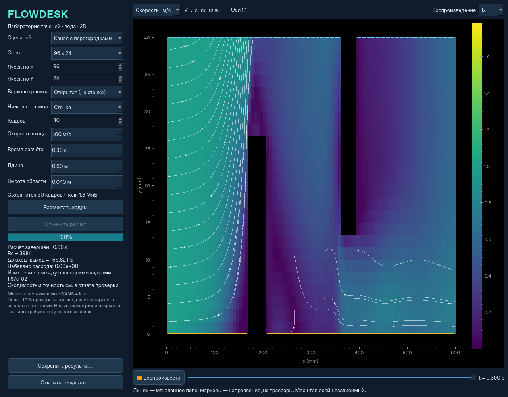

# FlowDesk

Настольная 2D CAE-программа для моделирования турбулентного течения воды.
Собственный расчётный движок: несжимаемые RANS, стандартная k–ε,
структурированная сетка конечных объёмов и коррекция давления.



## Запуск

Нужен **64-битный Python 3.12** и доступ к PyPI при первой установке.

- **Windows:** запустите `run.bat` из распакованного репозитория. Скрипт создаст
  `.venv`, установит зависимости и откроет приложение.
- **Linux / macOS:** `bash run.sh`. На Linux нужен рабочий графический сеанс и
  системные библиотеки Qt/X11. В облачной среде проверен запуск через Qt offscreen.

Для тестов без экрана на Ubuntu/Debian нужны и системные зависимости Qt
(Python-пакет PySide6 не включает их):

```sh
sudo apt-get update
sudo apt-get install -y libegl1 libgl1 libxkbcommon0 libdbus-1-3
QT_QPA_PLATFORM=offscreen python -m pytest -q
```

Режим `offscreen` не отменяет зависимость QtGui от `libEGL.so.1`.

Либо установите вручную:

```sh
python -m venv .venv
# Linux/macOS:
.venv/bin/python -m pip install -r requirements-lock.txt
.venv/bin/python -m pip install --no-deps -e .
.venv/bin/python -m flowdesk
# Windows: вместо .venv/bin/python используйте .venv\Scripts\python.exe
```

Это приложение из исходников, не готовый установщик Windows. Численные расчёты,
GUI и рабочий процесс проверены на Linux/Python 3.12. Запуск на Windows/macOS
предусмотрен, но на этих ОС в данной среде не проверялся.

## Как пользоваться

1. Выберите **канал, обратную ступеньку, сужение, симметричное расширение,
   цилиндр или перегородки**.
2. Задайте сетку, верхнюю/нижнюю границы, скорость входа, длительность и размеры.
3. Нажмите **«Рассчитать кадры»**. Расчёт выполняется в отдельном процессе;
   доступна отмена. Текущее решение сохраняется в памяти после завершения.
4. Выберите поле **скорости** или **статического давления**, включите линии тока.
5. Воспроизводите, перематывайте и меняйте скорость анимации. Между рассчитанными
   кадрами применяется линейная интерполяция; частота интерфейса — около 30 кадров/с.
6. Сохраните результат в `.npz` и откройте позже без повторного расчёта.

Все величины в СИ. Вода: ρ = 998.2 кг/м³, ν = 1.004·10⁻⁶ м²/с.
Геометрия ступеньки: нижняя половина входного участка длиной L/5 занята стенкой;
отношение высот 1:2. Высота в настройках — высота **выходного** канала.
На входе задана скорость, на выходе — относительное механическое давление 0.
На стенках нет нормального потока; касательное напряжение задаёт пристеночная функция.

Другие геометрии: сужение после x = 0.4L до H/2; симметричное расширение
после x = L/4 от H/2 до H; цилиндр радиусом H/6 в точке (0.3L, 0.5H);
две перегородки толщиной 0.06L на x = 0.28L и 0.60L, перекрывающие 65% высоты
с противоположных сторон. Криволинейный цилиндр аппроксимируется ячейками;
на грубой сетке его форма ступенчатая.

**Верхняя и нижняя границы** настраиваются независимо: «Стенка» или
«Открытая (не стенка)». У открытой границы механическое давление равно 0,
есть нормальный поток, нет стеночного трения и пристеночного k–ε-условия.
Скорость прогнозируется с нулевым нормальным градиентом, затем корректируется
давлением. При обратном потоке задаются входные k и epsilon.
Это открытая граница давления, **не свободная поверхность жидкости**, не
периодичность и не непроницаемая скользящая стенка. Твёрдые части геометрии
остаются твёрдыми. Жёлтая линия обозначает стенку, голубой пунктир — открытую границу.
Баланс расхода учитывает также верх и низ; расходы на входе и правом выходе
при открытых боковых границах могут различаться.

**Сетки:** пресеты от 64×16 до 1024×256 и 1024×1024, а также произвольные
Nx = 16…1024 и Ny = 8…1024. Поля кадров хранятся в float32. Бюджет сохранённых
полей ограничен 256 МиБ: на 1024² при запросе 80 кадров сохраняются 12 кадров
через равные интервалы всего расчёта. Предварительная оценка показана в окне.
Это ограничение памяти кадров, не общей памяти приложения; решатель и передача
результата требуют дополнительной памяти. Межкадровая интерполяция не добавляет
физически рассчитанных состояний.

Большая сетка не рассчитана на завершение за секунды: явная схема требует
меньшего шага времени. Для 1024² проверен короткий расчёт с настоящим шагом,
а не полный интервал 1.2 с. Для прямоугольной области используется быстрый
FFT-решатель давления; для больших областей с препятствиями — итерационный CG
с предобусловливанием. Увеличение сетки у стенки не обеспечивает автоматически
точность высокорейнольдсовой модели k–ε.

У полей общий цветовой диапазон для всех кадров. Масштаб осей по умолчанию
независимый для читаемости длинного канала; **«Оси 1:1»** возвращает геометрические
пропорции. Белые линии — линии тока мгновенного поля. Бегущие маркеры лишь
показывают направление: это не физические частицы и не траектории переноса.
У стационарного течения само поле перестаёт меняться.
Геометрия линий тока обновляется в фоновом потоке по выборочным мгновенным
полям; во время воспроизведения возможна небольшая задержка линий относительно
цветового поля. На паузе линии догоняют выбранный кадр.

## Проверка давления и быстродействия

```sh
python -m pytest -q
python -m flowdesk.benchmark --output results/validation.json --save-frames
python -m flowdesk.benchmark --extended --output results/extended-validation.json
```

Команды выполняются Python из установленного окружения. Вторая команда сохраняет
также `channel.npz` и `step.npz`, которые можно открыть в окне программы.
Эталонное сравнение и измеренные времена: [docs/validation.json](docs/validation.json).
Новые сценарии и короткие проверки больших сеток: [docs/extended-validation.json](docs/extended-validation.json).

Для стандартной воды, U = 1 м/с, L = 0.6 м, H = 0.04 м, Re_H ≈ 39841,
после 1.2 с расчётного времени перепад между сечениями x ≈ 0.39 и 0.54 м
сравнивается с корреляцией Дина для развитого турбулентного течения
в гладком плоском канале:

`Cf = 0.073 Re_H^(-1/4)`, `Δp = Cf ρ Ub² Δx / H`.

| Сетка | Перепад, Па | По Дину, Па | Отклонение |
|---|---:|---:|---:|
| 64 × 16 | 20.97 | 19.34 | 8.43% |
| 96 × 24 | 20.28 | 19.34 | 4.87% |
| 144 × 36 | 20.12 | 19.34 | 4.04% |

Типичное время в этой облачной среде — 1–5 с для канала и около 3 с для ступеньки
на стандартной сетке. Это измерения, не гарантия времени на другом компьютере.
Начальная установка Qt занимает существенно больше времени, чем расчёт.

**Область подтверждения ±10% ограничена указанным перепадом и режимом.**
Корреляция — инженерный ориентир, не экспериментальная валидация всего поля.
Перепад вход–выход включает входные потери и не равен перепаду выбранного
контрольного участка. Для ступеньки подтверждены баланс массы и рециркуляция,
но точность давления относительно эксперимента не подтверждена. Время 1.2 с
не гарантирует стационарности ступеньки; увеличьте длительность для её исследования.

## Ограничения модели

- Это компактный исследовательский движок, а не сертифицированный промышленный CAE.
- k–ε — модель осреднённой турбулентности. Мелкие вихри и реальная турбулентная
  пульсация не разрешаются; отображается эволюция среднего поля.
- Гладкие неподвижные стенки, одна несжимаемая ньютоновская жидкость,
  постоянные свойства. Свободная поверхность, кавитация, теплообмен и 3D отсутствуют.
- Пристеночные функции предназначены для высоких Re, преимущественно y⁺ ≈ 30–300;
  произвольное уменьшение ячеек у стенки или скорости не гарантирует улучшения.
- Противопоточная схема первого порядка добавляет численную диффузию.
  Для новых режимов нужна проверка сеточной и временной сходимости и отдельный эталон.
- Малая дивергенция означает выполнение неразрывности, а не точность модели.
  В отчёте отдельно показано изменение скорости между последними кадрами.

Описание алгоритма, констант и источников: [docs/numerics.md](docs/numerics.md).

## Структура

- `flowdesk/solver.py` — независимый от GUI решатель и формат результатов.
- `flowdesk/gui.py` — настольное приложение, отдельный процесс расчёта и плеер.
- `flowdesk/visualization.py` — интегрирование линий тока методом средней точки.
- `flowdesk/benchmark.py` — воспроизводимое сравнение давления и тайминги.
- `tests/` — численные и сквозной GUI-тесты, включая реальный дочерний процесс.

Numba не требуется. Небольшие сетки рассчитываются через NumPy/SciPy.
Режим решения давления автоматически выбирается по геометрии и числу ячеек.
