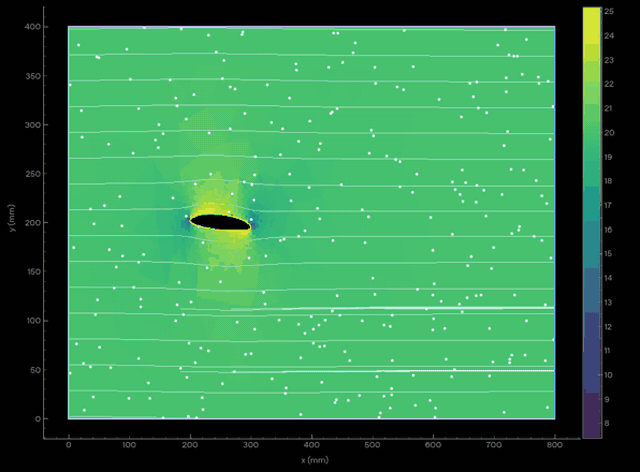

# FlowDesk

Настольная 2D CAE-программа для моделирования несжимаемого течения и теплообмена.
Собственный расчётный движок: несжимаемые RANS, стандартная k–ε,
конечные объёмы, стационарный SIMPLE и нестационарные расчёты на прямоугольных,
треугольных и четырёхугольных сетках.


## Запуск

Нужен **64-битный Python 3.12** и доступ к PyPI при первой установке.

- **Windows:** запустите `run.bat` из распакованного репозитория. Скрипт создаст
  `.venv`, установит зависимости и откроет приложение.
- **Linux / macOS:** `bash run.sh`. На Linux нужен рабочий графический сеанс и
  системные библиотеки Qt/X11. В облачной среде проверен запуск через Qt offscreen.

Для тестов без экрана на Ubuntu/Debian нужны и системные зависимости Qt
(Python-пакет PySide6 не включает их):

```sh
sudo apt-get update
sudo apt-get install -y libegl1 libgl1 libglu1-mesa libxkbcommon0 libdbus-1-3 libxrender1 libxcursor1 libxfixes3 libxext6 libxft2 libxinerama1 libfontconfig1 libgomp1
QT_QPA_PLATFORM=offscreen python -m pytest -q
```

Режим `offscreen` не отменяет зависимость QtGui от `libEGL.so.1`.

Либо установите вручную:

```sh
python -m venv .venv
# Linux/macOS:
.venv/bin/python -m pip install -r requirements-lock.txt
.venv/bin/python -m pip install --no-deps -e .
.venv/bin/python -m flowdesk
# Windows: вместо .venv/bin/python используйте .venv\Scripts\python.exe
```

Это приложение из исходников, не готовый установщик Windows. Численные расчёты,
GUI и рабочий процесс проверены на Linux/Python 3.12. Запуск на Windows/macOS
предусмотрен, но на этих ОС в данной среде не проверялся.

## Как пользоваться

**Физика подключается независимо:** галочка **«Модель турбулентности k–ε»**
включает турбулентный расчёт; без неё поток ламинарный. Галочка **«Уравнение
энергии · температура»** добавляет перенос и теплопроводность, входную/начальную
температуру, теплоизоляцию либо температуру стенок, cp, λ, Prt и объёмный источник.
Температура отображается и анимируется через пункт **«Температура · K»**.
Обе опции работают в стационарном и нестационарном режимах на всех сетках.
Свойства постоянные; температура не влияет на плотность/вязкость и не создаёт
плавучесть. [Уравнение, настройки и проверки](docs/energy.md).


**Готовая продувка профиля:** выберите сценарий «Продувка · несимметричный
эллиптический профиль». Он использует воздух (ρ = 1.225 кг/м³, ν = 1.5e−5 м²/с),
скорость по умолчанию 20 м/с, хорду 0.1 м и угол атаки +4°.
Верхняя и нижняя эллиптические поверхности имеют высоты 0.10c и 0.06c.
Параметры угла, хорды и числа элементов доступны в форме.

По умолчанию выбран **«Нестационарный · анимация полей»**. Для профиля предлагается
0.025 с физического времени: расчёт сохраняет развитие скорости, давления и следа
при развитии обтекания. Начальное состояние — движущийся поток, скорректированный
на непроницаемые стенки; для своей сетки и профиля также можно выбрать пуск из покоя. После завершения нажмите **«▶ Воспроизвести»**. При 1× весь
нестационарный расчёт проигрывается за 8 секунд; ползунок позволяет выбрать момент.
Цветовое поле переключается между скоростью и давлением. Белые частицы со шлейфами
движутся по рассчитанному полю, линии тока обновляются по времени. Цветовая шкала
фиксирована для всей записи, давление имеет симметричную шкалу относительно нуля.

**«Макс. шаг времени»** позволяет ограничить физический шаг независимо от частоты
просмотра (0 — авто). Для проверки временной сходимости уменьшайте его вдвое.
Подробнее о численной схеме и проверках: [docs/transient.md](docs/transient.md).



После расчёта нажмите **«Графики Cl / Cd / Cl/Cd…»**:

- В нестационарном режиме «История» показывает Cl, Cd и Cl/Cd по физическому времени.
  В стационарном — по итерациям SIMPLE.
- В стационарном режиме «Поляра» показывает эти величины по углу атаки. Флажок **«Поляра по углу атаки»**
  включает серию независимых расчётов; по умолчанию −4°, 0°, +4°, +8°.
  Для быстрого одиночного расчёта снимите флажок. Дополнительная серия занимает
  больше времени; в окне виден текущий угол. Результат поля сохраняется для основного угла.
- Доступны таблица и CSV. Несошедшиеся углы помечаются крестиками и не соединяются
  как достоверные точки поляры. История и поляра сохраняются вместе с NPZ и работают после открытия файла.

Cl/Cd вычисляются по давлению и пристеночному трению **только на профиле**,
на единичный размах; опорная длина — хорда. Расчёт идёт на реальных треугольных
элементах со сгущением у поверхности. Это исследовательский сценарий:
точность аэродинамических коэффициентов не подтверждена экспериментом.
Формулы, графики и проверка: [docs/airfoil.md](docs/airfoil.md).

Для своей геометрии нажмите **«Геометрия и сетка (DXF)…»**. Откроется отдельное
окно FlowDesk Mesh. Его также можно запустить независимо:

```sh
python -m flowdesk.mesh_gui
# Или flowdesk-mesh после установки пакета
```

1. Импортируйте DXF с **одним замкнутым внешним контуром жидкости** и, при
   необходимости, внутренними контурами твёрдых тел. Поддерживаются LINE,
   LWPOLYLINE/POLYLINE, ARC, CIRCLE, ELLIPSE, SPLINE и геометрия INSERT-блоков.
2. Проверьте единицы. По умолчанию используется `$INSUNITS`; если он не задан,
   выберите мм/см/м и импортируйте снова. Все дальнейшие настройки — в метрах.
   Координаты сдвигаются к нижнему левому углу модели; исходный сдвиг сохраняется.
3. Назначьте рёбрам вход, выход, стенку или открытую границу. Слои DXF `INLET`,
   `OUTLET`, `WALL`, `OPEN` распознаются автоматически. В чертеже без назначений
   левое вертикальное ребро становится входом, правое — выходом; обязательно
   проверьте это для своей формы. Ребро можно выбрать щелчком на рисунке.
4. Выберите **треугольники или четырёхугольники**, характерный размер ячейки либо
   целевое число элементов. Размер — параметр генератора, а не одинаковая длина
   каждого ребра. Число элементов приближённое, фактическое число показывается.
5. Для местного сгущения добавьте рамку, перетащите/измените её размер и задайте
   локальный `h` в таблице. Можно добавить несколько зон. Их размеры имеют
   приоритет над целевым общим количеством элементов; сетка остаётся согласованной.
6. Нажмите **«Построить сетку»**. Генератор работает в отдельном процессе, доступна
   отмена. Посмотрите фактическое число узлов/элементов и качество minSICN
   (идеал около 1; близкие к нулю значения требуют улучшения сетки).
7. **«Передать модель в расчёт»** сохранит самодостаточный `.flowmesh` и подключит
   его к основному окну. Файл содержит контуры, настройки, зоны, границы и элементы;
   исходный DXF для последующего расчёта уже не нужен. Доступен экспорт сетки `.msh`.

Собственная модель рассчитывается **непосредственно на построенных треугольниках
или четырёхугольниках**, конечно-объёмным SIMPLE/Rhie–Chow с k–ε; доступны
стационарный расчёт и нестационарный URANS с неявным шагом времени
на базе геометрических операторов FiPy. Равномерная сетка не подставляется вместо
построенной. Nx/Ny в основном окне для своей модели обозначают только пиксели
изображения и недоступны для редактирования. Входная скорость направлена внутрь
по нормали к назначенным входным граням, а не обязательно вдоль X.

Результат NPZ содержит и поля на исходных элементах. **«Поля на исходной сетке
(.vtu)…»** экспортирует их для ParaView и других приложений. Изображение в окне
использует значения реальных ячеек в каждом пикселе; исходные поля не теряются.
Стационарный результат можно открыть без исходного проекта сетки.

Примеры DXF в миллиметрах: [канал](examples/channel.dxf) и
[канал с препятствием](examples/channel_with_obstacle.dxf).
Готовый проект для быстрого запуска: [channel.flowmesh](examples/channel.flowmesh).
Описание ограничений и проверки: [docs/custom-mesh.md](docs/custom-mesh.md).

Для встроенных сценариев:

1. Выберите **канал, обратную ступеньку, сужение, симметричное расширение,
   цилиндр или перегородки**.
2. Выберите стационарный SIMPLE либо нестационарный режим. Задайте сетку,
   границы, скорость и размеры; для SIMPLE — лимит итераций и порог невязки,
   для нестационарного расчёта — физическую длительность.
3. Нажмите **«Рассчитать SIMPLE»** или **«Рассчитать кадры»**. Расчёт выполняется в отдельном процессе;
   доступна отмена. Текущее решение сохраняется в памяти после завершения.
4. Выберите поле **скорости** или **статического давления**, включите линии тока.
5. Воспроизводите, перематывайте и меняйте скорость анимации. Между рассчитанными
   кадрами применяется линейная интерполяция; частота интерфейса — около 30 кадров/с.
6. Сохраните результат в `.npz` и откройте позже без повторного расчёта.

**Стационарный SIMPLE** решает неявные уравнения переноса и диффузии импульса,
k и epsilon; корректирует давление и расход до сходимости. Остановка — когда
все нормированные невязки u, v, k, epsilon и неразрывности ниже порога
три итерации подряд (не ранее десятой итерации). По умолчанию порог 1e−4,
лимит 1000 итераций. Лимит не считается сходимостью: окно явно пишет
«НЕ СОШЛОСЬ». Графики доступны кнопкой **«Невязки SIMPLE…»**; история сохраняется в NPZ.
Сходимость дискретных уравнений не является подтверждением физической точности.

В SIMPLE сохраняется одно итоговое поле в виде двух одинаковых кадров для
проигрывателя. «Цикл анимации» задаёт только движение маркеров; это не физическое
время, не история пуска и не анимация рассчитанных вихрей. Если нужна эволюция
потока, выбирайте **«Нестационарный»**. Старые NPZ-файлы читаются как нестационарные.

**«Начать с грубой сетки»** предварительно решает небольшую задачу на том же
сценарии и интерполирует u/v с учётом их расположения на гранях, давление,
k и epsilon на целевую сетку. Затем SIMPLE продолжает расчёт и проверяет невязки
уже на целевой сетке. Грубое решение не подменяет конечный расчёт.

Все величины в СИ. Вода: ρ = 998.2 кг/м³, ν = 1.004·10⁻⁶ м²/с.
Геометрия ступеньки: нижняя половина входного участка длиной L/5 занята стенкой;
отношение высот 1:2. Высота в настройках — высота **выходного** канала.
На входе задана скорость, на выходе — относительное механическое давление 0.
На стенках нет нормального потока; касательное напряжение задаёт пристеночная функция.

Другие геометрии: сужение после x = 0.4L до H/2; симметричное расширение
после x = L/4 от H/2 до H; цилиндр радиусом H/6 в точке (0.3L, 0.5H);
две перегородки толщиной 0.06L на x = 0.28L и 0.60L, перекрывающие 65% высоты
с противоположных сторон. Криволинейный цилиндр аппроксимируется ячейками;
на грубой сетке его форма ступенчатая.

**Верхняя и нижняя границы** настраиваются независимо: «Стенка» или
«Открытая (не стенка)». У открытой границы механическое давление равно 0,
есть нормальный поток, нет стеночного трения и пристеночного k–ε-условия.
Скорость прогнозируется с нулевым нормальным градиентом, затем корректируется
давлением. При обратном потоке задаются входные k и epsilon.
Это открытая граница давления, **не свободная поверхность жидкости**, не
периодичность и не непроницаемая скользящая стенка. Твёрдые части геометрии
остаются твёрдыми. Жёлтая линия обозначает стенку, голубой пунктир — открытую границу.
Баланс расхода учитывает также верх и низ; расходы на входе и правом выходе
при открытых боковых границах могут различаться.

**Сетки:** пресеты от 64×16 до 1024×256 и 1024×1024, а также произвольные
Nx = 16…1024 и Ny = 8…1024. Поля кадров хранятся в float32. Бюджет сохранённых
полей в нестационарном режиме ограничен 256 МиБ: на 1024² при запросе 80 кадров сохраняются 12 кадров
через равные интервалы всего расчёта. Предварительная оценка показана в окне.
Это ограничение памяти кадров, не общей памяти приложения; решатель и передача
результата требуют дополнительной памяти. Межкадровая интерполяция не добавляет
физически рассчитанных состояний.

Большая сетка не рассчитана на завершение за секунды. Нестационарная явная схема требует
меньшего шага времени; SIMPLE требует больших разреженных линейных систем.
Для 1024² проверен короткий нестационарный расчёт с настоящим шагом,
а не полный интервал 1.2 с. Для прямоугольной области используется быстрый
FFT-решатель давления; для больших областей с препятствиями — итерационный CG
с предобусловливанием. Увеличение сетки у стенки не обеспечивает автоматически
точность высокорейнольдсовой модели k–ε.

У полей общий цветовой диапазон для всех кадров. Масштаб осей по умолчанию
независимый для читаемости длинного канала; **«Оси 1:1»** возвращает геометрические
пропорции. Белые линии — линии тока мгновенного поля. В нестационарном режиме частицы интегрируются по сохранённым полям скорости
методом RK2 со шлейфами. При перемотке они пересоздаются. В стационарном режиме
маркеры показывают только направление потока.
У стационарного течения само поле перестаёт меняться.
Геометрия линий тока обновляется в фоновом потоке по выборочным мгновенным
полям; во время воспроизведения возможна небольшая задержка линий относительно
цветового поля. На паузе линии догоняют выбранный кадр.

## Проверка давления и быстродействия

```sh
python -m pytest -q
python -m flowdesk.benchmark --output results/validation.json --save-frames
python -m flowdesk.benchmark --extended --output results/extended-validation.json
python -m flowdesk.benchmark --steady --output results/steady-validation.json
python -m flowdesk.mesh_check --with-obstacle --output results/custom-mesh-validation.json
python -m flowdesk.profile_check --output results/profile-validation.json
```

Команды выполняются Python из установленного окружения. Вторая команда сохраняет
также `channel.npz` и `step.npz`, которые можно открыть в окне программы.
Эталонное сравнение и измеренные времена: [docs/validation.json](docs/validation.json).
Новые сценарии и короткие проверки больших сеток: [docs/extended-validation.json](docs/extended-validation.json).
Сходимость SIMPLE: [docs/steady-validation.json](docs/steady-validation.json).
Сравнение скорости с версией b38241c: [docs/performance.json](docs/performance.json).
Проверка грубого старта: [docs/coarse-start.json](docs/coarse-start.json).

Ускорения: компиляция численных циклов через Numba без `fastmath`; неявный SIMPLE;
повторное использование LU/AMG-предобусловливателей; старт с грубой сетки;
ограничение BLAS одним потоком внутри расчёта, чтобы избежать накладных расходов
на многочисленные короткие операции. На маленьком прямом канале SIMPLE может
быть медленнее нестационарного режима. Первый запуск компилирует и кеширует
численные ядра; в сравнении производительности прогрев исключён.

Для воспроизведения сравнения исходники старой версии можно извлечь во временную
папку (без смены текущего checkout), затем выполнить:

```sh
mkdir -p /tmp/flowdesk-baseline
git archive b38241c flowdesk | tar -x -C /tmp/flowdesk-baseline
OPENBLAS_NUM_THREADS=1 python -m flowdesk.performance --baseline-source /tmp/flowdesk-baseline --baseline-commit b38241c --output results/performance.json
```

Для каждого сценария измеряются три запуска, публикуется медиана и различия
итоговых полей. Сравнение SIMPLE относится к установившемуся конечному состоянию,
а не к временной истории нестационарного решения.

Измерения на сетке 96×24 (секунды, медиана трёх запусков, без первой JIT-компиляции):

| Сценарий | Прежний движок | Новый нестационарный | SIMPLE до сходимости |
|---|---:|---:|---:|
| Канал | 1.03 | 0.68 | 1.44 |
| Сужение | 5.88 | 4.74 | 0.86 |
| Перегородки | 15.45 | 11.44 | 5.03 |

Для SIMPLE итоговое поле давления отличается от прежнего решения меньше чем
на 0.05% по относительной L2-норме в этих трёх случаях. Это проверка сохранения
результата при ускорении, а не новый экспериментальный эталон. Для малых сеток
канала выгоднее остался нестационарный режим. На 1024² полный стационарный расчёт
до сходимости здесь не измерялся; универсального ускорения или скорости ANSYS
эти результаты не устанавливают.

На дополнительной сетке канала 192×48 грубый старт сократил число итераций
целевой сетки с 215 до 189; итоговое поле давления отличается на 0.013% по L2.
Грубые итерации учитываются отдельно, поэтому это не равнозначно сокращению
общего времени на тот же процент. Для просмотра истории: [пример графика невязок](docs/residuals.png).

Для стандартной воды, U = 1 м/с, L = 0.6 м, H = 0.04 м, Re_H ≈ 39841,
после 1.2 с расчётного времени перепад между сечениями x ≈ 0.39 и 0.54 м
сравнивается с корреляцией Дина для развитого турбулентного течения
в гладком плоском канале:

`Cf = 0.073 Re_H^(-1/4)`, `Δp = Cf ρ Ub² Δx / H`.

| Сетка | Перепад, Па | По Дину, Па | Отклонение |
|---|---:|---:|---:|
| 64 × 16 | 20.97 | 19.34 | 8.43% |
| 96 × 24 | 20.28 | 19.34 | 4.87% |
| 144 × 36 | 20.12 | 19.34 | 4.04% |

Типичное время в этой облачной среде — 1–5 с для канала и около 3 с для ступеньки
на стандартной сетке. Это измерения, не гарантия времени на другом компьютере.
Начальная установка Qt занимает существенно больше времени, чем расчёт.

**Область подтверждения ±10% ограничена указанным перепадом и режимом.**
Корреляция — инженерный ориентир, не экспериментальная валидация всего поля.
Перепад вход–выход включает входные потери и не равен перепаду выбранного
контрольного участка. Для ступеньки подтверждены баланс массы и рециркуляция,
но точность давления относительно эксперимента не подтверждена. Время 1.2 с
не гарантирует стационарности ступеньки; увеличьте длительность для её исследования.

## Ограничения модели

- Это компактный исследовательский движок, а не сертифицированный промышленный CAE.
- k–ε — модель осреднённой турбулентности. Мелкие вихри и реальная турбулентная
  пульсация не разрешаются; отображается эволюция среднего поля.
- Гладкие неподвижные стенки, одна несжимаемая ньютоновская жидкость,
  постоянные свойства. Свободная поверхность, кавитация, теплообмен и 3D отсутствуют.
- Пристеночные функции предназначены для высоких Re, преимущественно y⁺ ≈ 30–300;
  произвольное уменьшение ячеек у стенки или скорости не гарантирует улучшения.
- Противопоточная схема первого порядка добавляет численную диффузию.
  Для новых режимов нужна проверка сеточной и временной сходимости и отдельный эталон.
- Малая дивергенция означает выполнение неразрывности, а не точность модели.
  В отчёте отдельно показано изменение скорости между последними кадрами.

Описание алгоритма, констант и источников: [docs/numerics.md](docs/numerics.md).

## Структура

- `flowdesk/solver.py` — независимый от GUI решатель и формат результатов.
- `flowdesk/steady.py` — неявный SIMPLE, AMG и перенос начального решения с грубой сетки.
- `flowdesk/kernels.py` — компилируемые численные операторы и сборка матриц.
- `flowdesk/cad.py`, `meshing.py`, `mesh_gui.py` — DXF, генерация Gmsh и отдельная утилита сетки.
- `flowdesk/unstructured.py` — SIMPLE/Rhie–Chow на реальных импортированных элементах.
- `flowdesk/airfoil.py`, `aero_gui.py` — готовый профиль, интегрирование сил, история и поляра.
- `flowdesk/gui.py` — настольное приложение, отдельный процесс расчёта и плеер.
- `flowdesk/visualization.py` — интегрирование линий тока методом средней точки.
- `flowdesk/benchmark.py` — воспроизводимое сравнение давления и тайминги.
- `tests/` — численные и сквозной GUI-тесты, включая реальный дочерний процесс.

Numba, PyAMG и threadpoolctl устанавливаются скриптами запуска вместе с остальными
зависимостями. Режим решения линейных систем выбирается по числу неизвестных.

## Если расчёт завершился ошибкой

Окно показывает последнюю строку исключения и полный прокручиваемый traceback.
Кнопки **«Копировать всё»** и **«Сохранить отчёт…»** передают весь текст, без обрезки
по высоте экрана. Автоматическая копия записывается в каталог `flowdesk` внутри
системного временного каталога; путь показан в окне. Отчёт содержит версии Python,
библиотек, параметры расчёта и статистику сетки, без чтения секретов окружения.

Исправлена совместимость неортогональной диффузии FiPy 4.0.3 с Python 3.14:
задание имени промежуточной переменной обходит несовместимый разбор нового
байткода. Неортогональная коррекция и численные уравнения сохранены. Воспроизведение
и проверка выполнены на Linux/Python 3.14; отдельная проверка Windows/Python 3.14
добавлена в GitHub Actions. `run.bat` / `run.sh` также проверяют версию приложения
и FiPy, чтобы после `git pull` обновить устаревшее виртуальное окружение.
