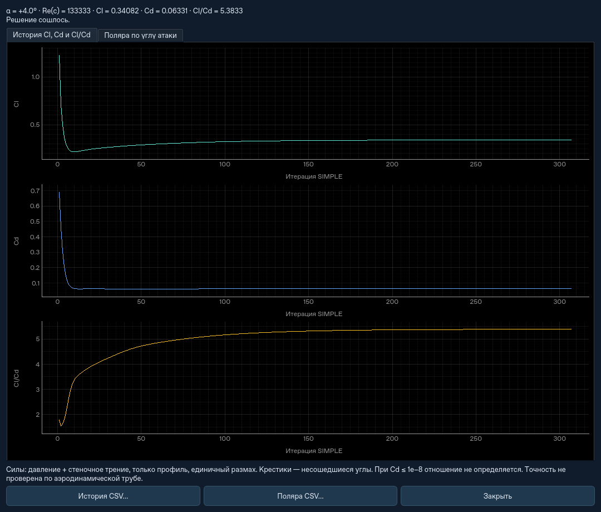
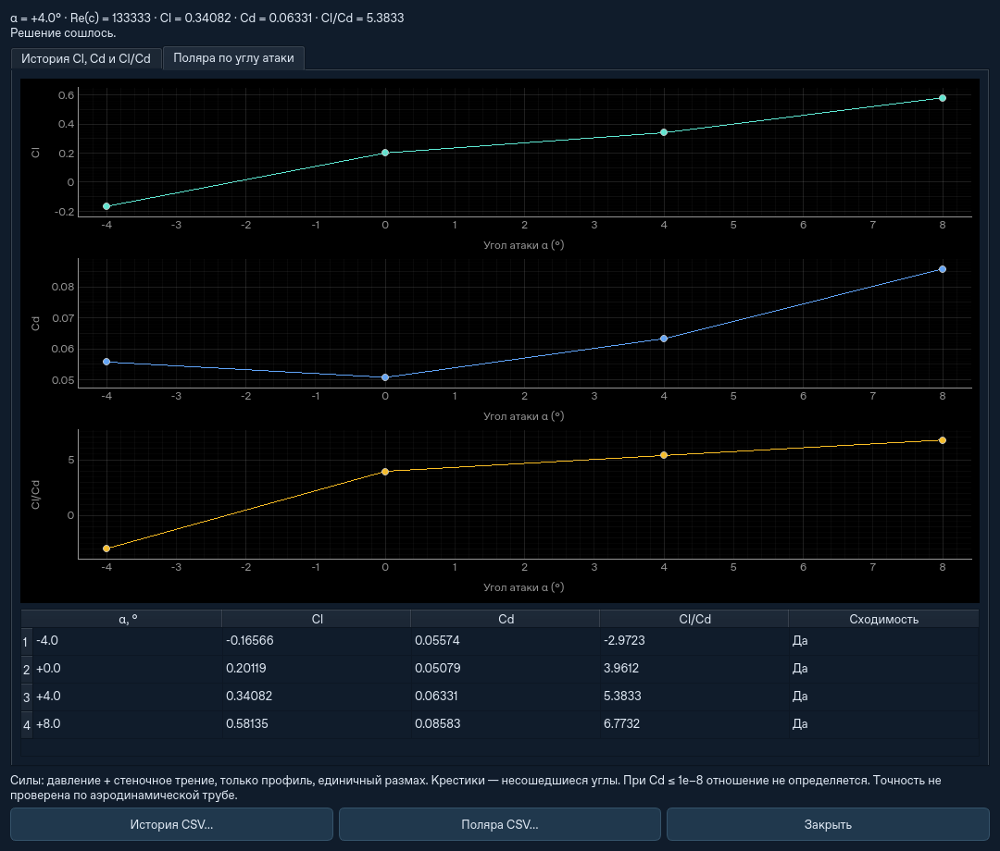

# Несимметричный эллиптический профиль и Cl/Cd





## Запуск

В основном окне выберите «Продувка · несимметричный эллиптический профиль».
По умолчанию: воздух ρ=1.225 кг/м³, ν=1.5e−5 м²/с; U∞=20 м/с;
интенсивность турбулентности 1%; c=0.1 м; α=+4°; Re(c)≈133333.
Угол, хорда, скорость и целевое число элементов изменяются в форме.

Для анимации развития обтекания оставьте нестационарный режим (по умолчанию).
Он сохраняет поля скорости и давления во времени и Cl(t), Cd(t), Cl/Cd(t).
После расчёта нажмите «▶ Воспроизвести». [Устройство и ограничения](transient.md).

В стационарном режиме флажок «Поляра по углу атаки» запускает отдельный расчёт для каждого угла
заданного диапазона. По умолчанию это −4°, 0°, +4°, +8°. Основной угол не
пересчитывается дважды. Для одиночного расчёта снимите флажок. Оба графика
открываются кнопкой «Графики Cl / Cd / Cl/Cd…» после окончания расчёта.

В стационарном режиме вкладки содержат историю коэффициентов по **итерациям**, поляру по углам,
таблицу и экспорт CSV. Это стационарные вычисления, не измерения физических
пульсаций подъёмной силы. Несошедшиеся точки видны отдельно; они не становятся
достоверными только потому, что для них получено число. При Cd≤1e−8 отношение
не вычисляется, на графике остаётся разрыв вместо бесконечного качества.

## Форма и границы

Для x от 0 до c:

```text
y_upper =  0.10 c sqrt(1 - (2x/c - 1)^2)
y_lower = -0.06 c sqrt(1 - (2x/c - 1)^2)
```

Толщина в середине — 16% хорды, максимальное смещение средней линии — 2%.
Это модель из двух половин эллипса, не стандартный профиль NACA и не профиль
с острым задним краем. Положительный α поднимает нос: при потоке вправо
геометрия вращается по часовой стрелке вокруг четверти хорды.

Расчётная область 8c × 4c. Нос расположен примерно на x=2c, профиль по высоте
около 2c. Слева задан вход, справа выход p*=0, верх и низ открыты p*=0.
Область конечная: границы могут влиять на силы, требуется проверка их удаления.
Используется треугольная сетка Gmsh с зоной сгущения у профиля. Минимально
допустимая цель — 400 элементов: более грубый вариант приводил к расходимости.
Цель по количеству приближённая; фактическое число сохраняется в отчёте.

DXF этой формы: [asymmetric-elliptic-profile.dxf](../examples/asymmetric-elliptic-profile.dxf).
Графики коэффициентов подключены именно к готовому сценарию профиля;
обычный импорт этого DXF остаётся общим расчётом своей модели.

## Силы и нормировка

На каждой поверхности профиля берутся фактические длины граней ds и нормали
n_f, направленные из жидкости в тело. Давление — статическое, из соседней
расчётной ячейки. Сила давления на тело:

```text
F_pressure = sum(p_static n_f ds)
```

Вязкая составляющая — противоположная сила касательного напряжения,
которое использует пристеночная функция решателя:

```text
F_shear = sum(rho u_tau^2 t ds)
F = F_pressure + F_shear
q = 0.5 rho U_inf^2
Cd = F_x / (q c)
Cl = F_y / (q c)
quality = Cl / Cd
```

t направлен по касательной скорости жидкости. Fx положителен по потоку,
Fy — вверх. Силы имеют размерность Н/м, то есть на единичный размах.
Внешние границы области в интеграл не входят. Нормировка использует
неповёрнутую геометрическую хорду, а не её проекцию на X.

## Проверки и пределы точности

- На круговом контуре с заданным линейным давлением интеграл воспроизводит
  аналитические Fx/Fy; знак, нормировка и постоянное смещение давления проверены.
- На касательной скорости в вязкой ветви проверено τ=rho nu U/y и направление трения.
- Проверены сохранение NPZ, CSV, обе вкладки графиков и честная несходимость по лимиту.
- Полная серия −4°, 0°, +4°, +8° на целевой сетке 800 сошлась. Фактическая сетка
  может отличаться между углами; это не сеточная сходимость и не эталонный эксперимент.

В этом прогоне получены ориентировочно:

| α | Cl | Cd | Cl/Cd |
|---:|---:|---:|---:|
| −4° | −0.16566 | 0.05574 | −2.972 |
| 0° | 0.20119 | 0.05079 | 3.961 |
| +4° | 0.34082 | 0.06331 | 5.383 |
| +8° | 0.58135 | 0.08583 | 6.773 |

**Эти числа не подтверждены в аэродинамической трубе.** Погрешность ±10% для
Cl/Cd не заявляется. Влияние сетки, положения внешних границ, пристеночных y+
и модели турбулентности нужно исследовать отдельно. На более грубой сетке
подъёмная сила заметно отличалась; малые невязки этого не устраняют.
Стандартная k–ε ограниченно описывает отрыв и срыв; график не является
подтверждённой полярой реального крыла или гарантией оптимального угла.

Полные данные: [profile-validation.json](profile-validation.json),
[profile-polar.csv](profile-polar.csv).

```sh
python -m flowdesk.profile_check --output results/profile-validation.json
# Быстрая проверка одного угла:
python -m flowdesk.profile_check --cells 400 --angles 4 --output results/profile-check.json
```

Команда сохраняет NPZ для повторного открытия графиков и два CSV.
История итераций и все точки поляры также включены в обычный файл результата.
