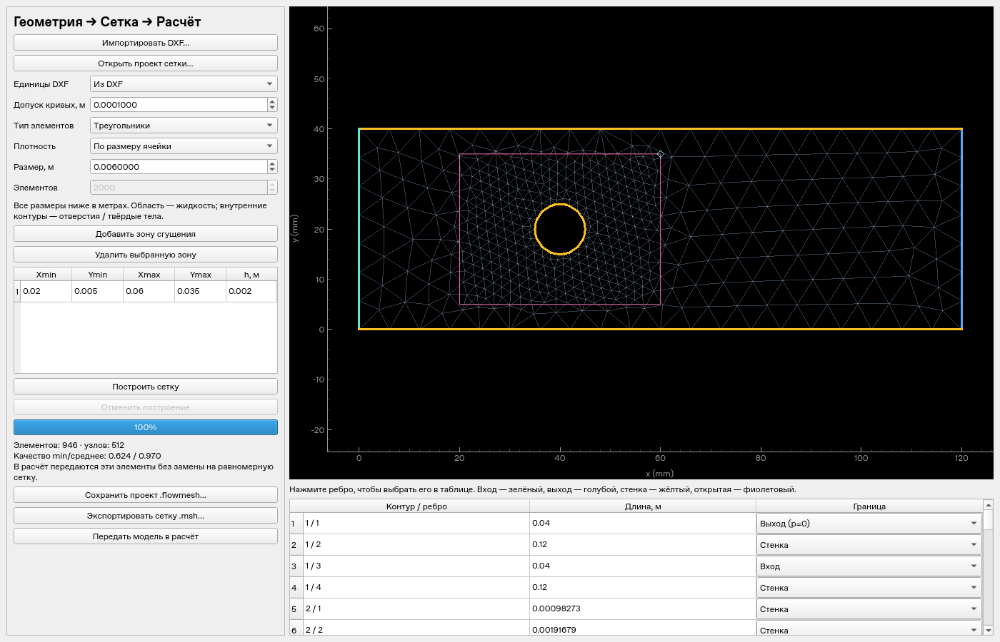
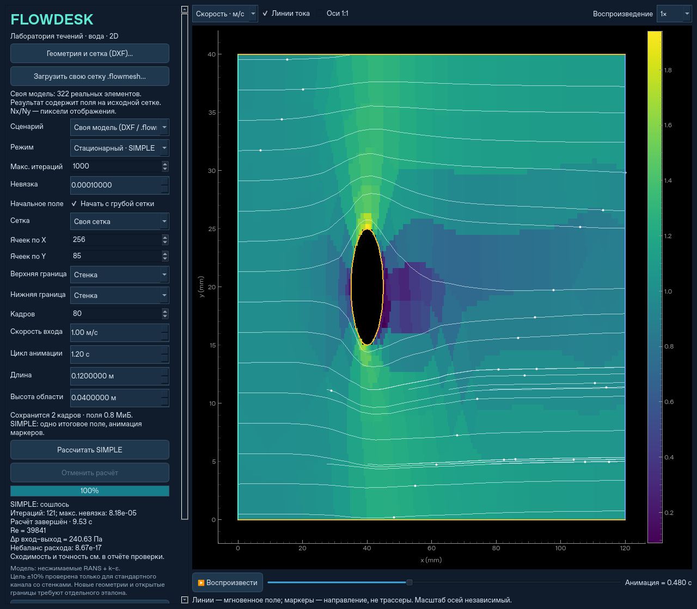

# Своя 2D-модель: DXF → элементы → расчёт



Примеры: `examples/channel.dxf` и `examples/channel_with_obstacle.dxf`, единицы мм.
Готовая четырёхугольная сетка: `examples/channel.flowmesh`.
Запуск: `python -m flowdesk.mesh_gui`, либо кнопка «Геометрия и сетка (DXF)…»
в основном окне. После установки пакета также доступна команда `flowdesk-mesh`.
На Linux Gmsh требует `libGLU.so.1` (`sudo apt-get install libglu1-mesa`).

## Геометрия и настройки

Внешний замкнутый контур задаёт жидкость. Внутренние контуры — отверстия/твёрдые
тела. Поддерживается одна связная плоская область; вложенные острова внутри
отверстий и несколько независимых областей нужно разделить на отдельные модели.
Незамкнутые/лишние линии, самопересечения и неплоская 3D-геометрия отклоняются.
Удалите вспомогательные линии из DXF. Формат DWG не читается: сохраните DXF в CAD.

Кривые, в том числе bulge-сегменты полилиний, аппроксимируются отрезками с заданным
допуском в метрах. Это не CAD-редактор: окно назначает границы и сетку, а изменение
формы выполняется в исходной CAD-программе. Концы отрезков при сборке контуров
приводятся к допуску примерно 1e−9 габарита, чтобы убрать погрешность совпадения;
видимые разрывы автоматически не зашиваются.

Генератор Gmsh строит линейные треугольники или полностью четырёхугольные элементы.
Четырёхугольники получаются рекомбинацией и согласованным подразделением, включая
необъединённые треугольники; это не декоративное изображение и не смешанная сетка.
После генерации выполняется сглаживание внутренних узлов.

Глобальный и локальный h задают характерную длину рёбер. На кривых, переходах
сгущения и в четырёхугольной сетке размеры различаются. Целевое количество
элементов подбирается до четырёх построений с коррекцией h; сохраняется ближайшая
к цели из полученных сеток, обычно до ±10%, но
локальные размеры и дискретизация контуров могут не позволить достичь цели.
Фактическое число и качество показаны в окне. Лимит генератора — 1 млн элементов;
это верхняя граница, а не гарантия приемлемого времени и памяти для CFD.

Зоны сгущения задаются прямоугольными перетаскиваемыми рамками и таблицей
`xmin, ymin, xmax, ymax, h`. Зона уточняет реальную сетку; переход сглаживается.
При большой сетке в просмотре показывается до 20000 рёбер с явной отметкой,
но сохраняются, экспортируются и рассчитываются все элементы.

Границы назначаются каждому сегменту DXF. Общее имя слоя назначает его всем
сегментам исходного объекта, затем отдельные рёбра можно переопределить в таблице.
Вход задаёт скорость по внутренней нормали. Выход и открытая граница задают
механическое давление 0 и допускают поток в обе стороны. Стенка непроницаема,
её касательное напряжение определяется пристеночной функцией.

## Расчёт на неструктурированных элементах



Для встроенных сценариев сохранён прежний быстрый MAC-решатель. Для своей модели
используется отдельный конечно-объёмный collocated SIMPLE с Rhie–Chow. Он получает
исходные вершины, грани и ячейки — преобразования в прямоугольные расчётные ячейки нет.
Доступны стационарный SIMPLE и нестационарный URANS: неявный Эйлер по времени,
внутренние итерации SIMPLE на каждом физическом шаге. В нестационарном режиме
сохраняются разные поля u/v/p/k/epsilon; можно выбрать начальный движущийся
поток или пуск из покоя. Подробности и управление
шагом: [transient.md](transient.md).

FiPy **4.0.3** собирает консервативные операторы переноса первого порядка и диффузии
с неортогональной коррекцией для импульса/k/epsilon. Узкий адаптер сборки использует
его внутренний API, поэтому версия закреплена и проверена тестами. Давление
корректируется с коэффициентом из релаксированной диагонали импульса. Rhie–Chow
связывает давление и поток на collocated-сетке, предотвращая шахматное давление.
Коррекция потоков использует те же межъячеечные проводимости, что матрица давления;
проверяется локальная неразрывность и суммарный расход через все внешние грани.

Уравнения решаются теми же разреженными LU/AMG-предобусловленными методами.
Модель k–ε и её константы соответствуют основному движку. Стеночное напряжение
приложено по касательной к каждой фактической грани; расстояние вычисляется от
центра соседней ячейки до этой грани. Значения k/epsilon в стеночных ячейках
задаются пристеночной функцией, а не координатой строки прямоугольной сетки.
При обратном потоке на открытой границе для k/epsilon используется входной фон.

Критерий сходимости — невязки u/v/k/epsilon и неразрывности ниже выбранного порога
три итерации подряд. Достижение лимита явно помечается как «НЕ СОШЛОСЬ».
Обратный поток на выходе может требовать удлинения области. Наличие нормального
качества сетки и сходимости не доказывает точность модели турбулентности.

**Для импортированных моделей погрешность давления ±10% не подтверждена.**
Проверки здесь демонстрируют численный рабочий процесс, сохранение геометрии,
типов элементов, сгущения и массы. Экспериментальный/аналитический эталон,
сеточная сходимость и правильные пристеночные y+ требуются для каждого нового режима.
Уменьшение h у стенки может нарушить применимость высокорейнольдсовой стеночной
функции. Автоматического расчёта пристеночных слоёв и контроля y+ пока нет.

k–ε и [уравнение энергии](energy.md) включаются независимыми галочками в основном окне.
В VTU при включённой энергии дополнительно сохраняется итоговое поле `temperature` (K).

## Файлы и воспроизведение

- `.flowmesh` — NPZ без pickle: контуры, единицы/сдвиг, границы, настройки, зоны,
  узлы, реальные элементы и качество; проект открывается и редактируется повторно.
- `.msh` — экспорт Gmsh 2.2 с физическими группами входа/выхода/стенок.
- `.npz` результата — изображаемые поля и дополнительно `native_*` с вершинами,
  элементами и итоговыми пятью полями на исходных ячейках; временная запись
  отображаемых полей хранится отдельно; проект не нужен для просмотра.
- `.vtu` — исходная неструктурированная сетка с итоговыми u/v/p/k/epsilon для ParaView.

```sh
python -m pytest -q
python -m flowdesk.mesh_check --with-obstacle --output results/custom-mesh-validation.json
```

Команда создаёт проекты обеих типов сетки, выполняет расчёты, экспортирует VTU
и сохраняет фактические невязки и баланс расхода. Отчёт текущей проверки:
[custom-mesh-validation.json](custom-mesh-validation.json).

Справочные реализации: [Gmsh](https://gmsh.info/),
[ezdxf](https://ezdxf.readthedocs.io/),
[FiPy SIMPLE/Rhie–Chow](https://pages.nist.gov/fipy/en/stable/generated/examples.flow.stokesCavity.html).
