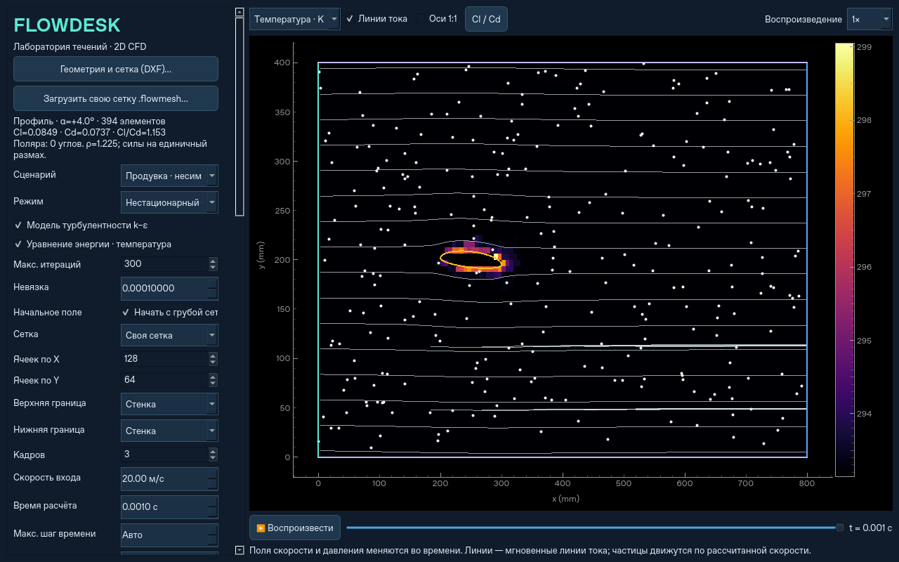

# Выбор физики: ламинарный поток, k–ε и энергия



В форме расчёта две независимые галочки:

- **«Модель турбулентности k–ε»** (по умолчанию включена). Если её снять,
  рассчитываются ламинарные несжимаемые уравнения Навье–Стокса. Турбулентная
  вязкость равна нулю, уравнения переноса k/epsilon не собираются и не решаются,
  в результатах k и epsilon равны нулю. Трение на стенке определяется вязким
  градиентом скорости вместо логарифмической стеночной функции. Cl/Cd также
  используют соответствующую выбранной модели силу трения.
- **«Уравнение энергии · температура»** (по умолчанию выключена). Включает
  температурное поле в стационарном или нестационарном расчёте. Совместимо с
  обоими вариантами течения и со всеми типами сеток. Без этой галочки матрица
  температуры не собирается, температурные кадры не выделяются.

Для просмотра после расчёта выберите **«Температура · K»** над полем.
Доступны те же воспроизведение, перемотка и линии тока. Цветовая шкала температуры
фиксирована для всех кадров записи. В старых результатах без энергии этот
пункт отключён. Тепловые параметры и вся запись температуры сохраняются в NPZ;
экспорт VTU своей сетки включает итоговую температуру на реальных элементах.

## Уравнение и свойства

Решается уравнение явного тепла для жидкости с постоянными свойствами:

```text
ρ cp [∂T/∂t + div(U T)] = div[(λ + ρ cp νt / Prt) grad(T)] + Q
αeff = λ/(ρ cp) + νt/Prt
```

`T` в K, `cp` — Дж/(кг·К), `λ` — Вт/(м·К), `Q` — Вт/м³. Без k–ε
`νt=0`, поэтому перенос тепла определяется молекулярной теплопроводностью.
Турбулентное число Прандтля `Prt=0.85` изменяется в форме. По умолчанию свойства
воды: cp=4182, λ=0.6; сценарий профиля предлагает воздух: cp=1005, λ=0.0257.
Плотность и вязкость соответствуют выбранному сценарию, как и в расчёте течения.

Это перенос тепла при постоянных свойствах: температура не меняет плотность
или вязкость. Плавучесть, сжимаемость, работа давления, вязкое тепловыделение,
излучение и теплопроводность внутри твёрдых тел в эту модель не входят.

## Граничные и начальные условия

- «Температура входа» применяется ко входным граням и к жидкости, входящей
  обратно через открытые границы/выход. На выходящем потоке градиент температуры
  по нормали равен нулю.
- «Начальная температура» задаёт начальное поле нестационарного расчёта;
  в стационарном режиме она не влияет на установившееся решение.
- «Стенки: теплообмен» — теплоизоляция (нулевой тепловой поток) либо заданная
  температура. Одна температура стенок применяется ко всем граням «wall»,
  включая поверхность препятствия. Открытые верх/низ стенками не становятся.
- «Объёмный источник тепла» равномерно нагревает жидкость при Q>0 или охлаждает
  при Q<0. По умолчанию Q=0. Температуры и положительные теплофизические свойства
  проверяются; получение неположительной абсолютной температуры останавливает расчёт.

Для первой анимации нагрева: включите энергию, выберите заданную температуру
стенок 333.15 K, вход и начальное поле 293.15 K. Для стационарного нагрева канала
можно использовать SIMPLE. Для временного изменения выберите нестационарный
режим и достаточную длительность. Физическое время нагрева зависит от свойств,
скорости, размеров и сетки.

## Численная схема и баланс

На прямоугольных сетках температура в нестационарном режиме переносится
консервативным donor-cell, диффузия — конечными объёмами. Автоматический явный
шаг учитывает также тепловую диффузию. В стационарном режиме после расчёта
течения решается линейная неявная задача энергии на его окончательных потоках.
Начальное приближение течения на грубой сетке не требует расчёта температуры.

На треугольниках/четырёхугольниках используется та же исходная сетка и те же
консервативные потоки через грани, что и в SIMPLE. Перенос upwind, диффузия
неявная, по времени — Backward Euler. Сначала сходится физический шаг течения,
затем решается энергия с зафиксированными потоками и турбулентной вязкостью.
Неортогональная поправка диффузии применяется на общих гранях; граничные
проводимости используют расстояние от центра ячейки до плоскости грани.
Это сохраняет нулевой тепловой поток на теплоизолированных/открытых гранях.
Температура задаётся на стеночной грани, а не в центре соседней ячейки.

Вычисляется `theta=T−Tin`, чтобы однородная температура точно сохранялась при
нулевом источнике и теплоизоляции. В `diagnostics.energy` сохраняются диапазон
температур и тепловой баланс на единицу размаха (Вт/м):

```text
накопление + выходящий адвективный поток
    = тепло от стенок + теплопроводность через вход + объёмный источник
```

Положительный `wall_heat_w_per_m` означает нагрев жидкости стенками;
`relative_imbalance` — относительная невязка этого баланса. В нестационарном режиме
сохраняется история: для прямоугольной сетки — баланс последнего физического шага
перед каждым кадром, для своей сетки — каждого шага времени. Баланс не является
оценкой физической точности теплообмена.

## Проверки и точность

`tests/test_physics.py` сравнивает ламинарный канал с профилем/градиентом давления
Пуазёйля, стационарный перенос тепла с аналитическим решением и уменьшением
ячейки вдвое, нестационарную теплопроводность — с решением через erfc.
Проверяется независимость поля течения от галочки энергии при постоянных свойствах,
сохранение однородной температуры, тепловой баланс и загрузка старых файлов.
`tests/test_native_energy.py` проверяет нагрев на обоих типах исходных элементов,
ламинарный и турбулентный режимы, вход через открытые границы, баланс энергии,
NPZ и VTU. `tests/test_thermal_gui.py` запускает настоящий расчёт из интерфейса,
проверяет температурную анимацию, загрузку и обе галочки.

Точность теплового потока ±10% для произвольных сеток пока не подтверждена.
Особенно для k–ε у стенки нужны разрешение теплового пограничного слоя,
сеточная/временная сходимость и эталон. Специальной тепловой стеночной функции
пока нет: используется эффективная диффузия до стеночной грани.

Температуру можно выбрать и во время расчёта: [живой предпросмотр](live-preview.md).
