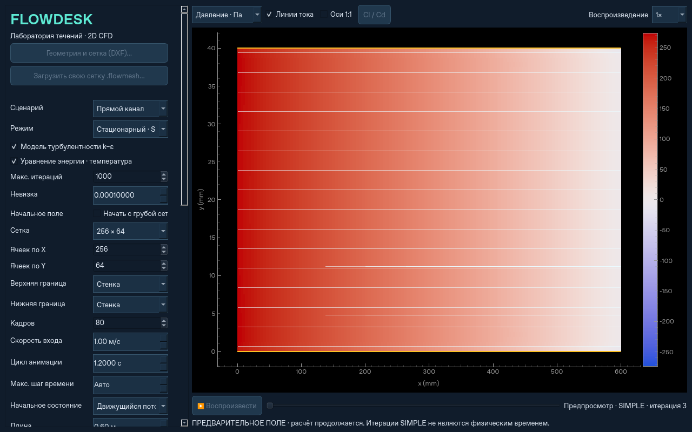

# Поле во время расчёта

После запуска расчёта поле в основном окне обновляется автоматически,
без ожидания итогового результата. Можно переключать **скорость, давление
и температуру**, включать/выключать линии тока и менять масштаб мышью.
Предпросмотр работает в стационарном и нестационарном режимах, на прямоугольных
и импортированных треугольных/четырёхугольных сетках, для профиля и серии углов.

Под полем показываются номер итерации, стадия («SIMPLE», «грубая сетка»,
«энергия», «шаг»), а для нестационарного расчёта — физическое время.
В серии профиля указывается текущий угол атаки. Итерация 0 — начальное поле.
Поле явно помечено **«ПРЕДВАРИТЕЛЬНОЕ»**: отдельная итерация ещё может не
удовлетворять критерию сходимости. Внутри SIMPLE нестационарного расчёта время
обозначает целевой физический шаг, который пока решается. Итерации SIMPLE
не превращаются в историю физического времени.

При раздельном решении энергии температура начинает обновляться, когда решатель
переходит к её уравнению. Пока сходится поток, показывается имеющееся температурное
приближение. При начальном расчёте потока на грубой сетке температура ещё не
рассчитывается и температурное отображение временно недоступно.

Цветовая шкала предпросмотра автоматически подстраивается под текущее поле.
Линии тока строятся по последнему доступному приближению в фоновом потоке.
Частицы со шлейфами появляются при воспроизведении готовой временной записи;
во время итераций показываются мгновенные линии тока.

## Отзывчивость

Экран получает до пяти обновлений в секунду; быстрые промежуточные итерации
пропускаются. Первый и окончательный снимки передаются дополнительно.
Предпросмотр ограничен 320×192 пикселями float32. Численная сетка, физические
шаги и разрешение итоговых полей от этого не меняются. Для своей сетки
отображаются значения исходных ячеек и реальные контуры стенок/входов/выходов.

Между процессами используется один снимок в буфере общей памяти размером 2 МиБ.
Новый снимок заменяет предыдущий. Нет очереди изображений или фонового потока,
который ждёт чтения кадров при завершении рабочего процесса. Чтение и запись
не ждут занятую блокировку: отрисовка и решатель продолжают свою работу.
На очень сложных контурах, не помещающихся вместе с полями в буфер, точные
контурные линии предпросмотра опускаются; геометрия остаётся видна по маске поля.

## Завершение и отмена

Готовый результат заменяет предварительное изображение полями полного разрешения.
После нестационарного расчёта остаётся виден последний физический кадр; кнопка
воспроизведения запускает просмотр записи с начала.
Во время расчёта воспроизведение/перемотка готовой записи, загрузка, сохранение
и экспорт отключены, чтобы промежуточное приближение не было выдано за результат.
После отмены или ошибки восстанавливается предыдущий завершённый расчёт;
если его не было, поле очищается. Расчёт можно запустить повторно.

Программный API: `Solver(config).run(preview=callback)`, где `callback` получает
`flowdesk.live.PreviewFrame`. Дополнительный callback необязателен и не меняет
существующие аргументы `progress` и `cancel`.

Проверки: ограничение размера и частоты, отсутствие изменения итоговых полей,
поля исходных ячеек, грубая сетка/углы профиля, передача большого снимка между
spawn-процессами и завершение процесса без чтения снимков. Desktop-тест проверяет
изменение изображения до окончания расчёта, переключение поля и отмену с
восстановлением предыдущего результата.
