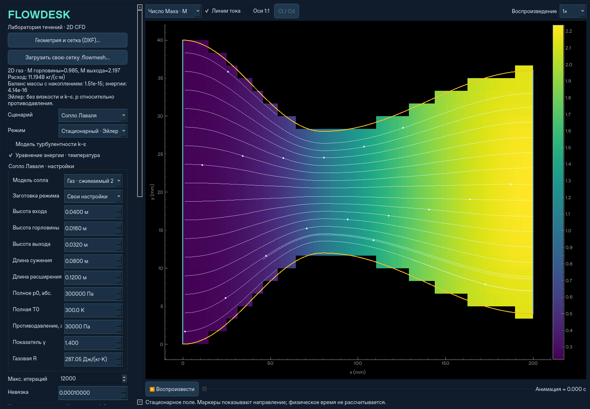

# Сопло Лаваля

Выберите сценарий **«Сопло Лаваля»**. Под выбором режима открывается отдельная
панель настройки сопла. По умолчанию выбрана газовая модель.

## Геометрия

Симметричное плоское 2D сопло задаётся высотами входа, горловины и выхода,
а также длинами сужающейся и расширяющейся частей. Контур плавно соединён
косинусами; наклон стенок в горловине равен нулю. Горловина должна быть уже входа
и выхода. Общие длина и высота области вычисляются из этих параметров.
Высоты — это расстояния между стенками, не диаметры круглого сопла.
Все расходы приводятся на единицу размаха: кг/(с·м).

По умолчанию: вход 40 мм, горловина 16 мм, выход 32 мм;
сужение 80 мм, расширение 120 мм. Nx/Ny задают число ячеек; доступны прежние
сетки вплоть до 1024×1024. На большой сетке явные акустические шаги существенно
увеличивают время расчёта. Поля записи при включённых температуре, Mach и плотности
ограничены общим бюджетом 256 МиБ (8 кадров на 1024²).

## Газ: сжимаемый 2D

Используется отдельный **двумерный консервативный решатель Эйлера** идеального
калорически совершенного газа. Решаются плотность, обе компоненты импульса и
полная энергия. Это не размноженное поперёк одномерное решение:
поперечная скорость и распределения по высоте рассчитываются на исходных ячейках.

Отдельные настройки:

- полное абсолютное давление p0 и полная температура T0 в резервуаре на входе;
- абсолютное противодавление pb на выходе, 0 < pb < p0;
- показатель адиабаты γ и удельная газовая постоянная R.

Значения по умолчанию: p0=300000 Па, T0=300 K, pb=30000 Па, γ=1.4, R=287.05 Дж/(кг·К).
Заготовки меняют противодавление: сверхзвуковой выход — 0.1p0, внутренний скачок —
0.75p0, дозвуковой поток — 0.97p0. Для скачка предлагается нестационарная запись
8 мс; её можно менять. Поля давления, температуры, скорости, **числа Маха** и
**плотности** доступны в списке над изображением. Давление в программе — статическое
относительно pb; отрицательное значение допустимо. Абсолютное давление равно p+pb.

Энергия в этом варианте обязательна, соответствующая галочка включена и заблокирована.
Стенки скользящие и теплоизолированные. Вязкость, k–ε, пристеночные слои, стеночный
нагрев и отрыв пограничного слоя **не моделируются**; галочка k–ε отключена.
Эта модель подходит для исследования запирания, разгона и газодинамических скачков,
но не заменяет вязкий расчёт реального сопла.

Начальное состояние — газ в покое при p0,T0. В нестационарном режиме рассчитывается
реальный пуск до выбранной физической секунды с записью полей. В стационарном —
шаги интегрирования продолжаются до сходимости или лимита. Учитывается акустический
CFL; «Макс. шаг времени» дополнительно ограничивает физический шаг.
Живой предпросмотр показывает стадии Эйлера во время расчёта.

На дозвуковом входе применяется условие резервуара по полной энтальпии,
энтропии и исходящей характеристике; на дозвуковом выходе — заданное давление
и исходящие энтропия/инвариант. При сверхзвуковом выходе характеристики направлены
наружу, поэтому давление pb не навязывается выходящему газу. Расчётное давление
среза может отличаться от pb: внешняя струя, её расширение и внешние скачки в
область расчёта не включены. При достаточно высоком pb скачок входит в сопло.

## Жидкость: несжимаемая

Этот вариант использует прежний решатель Навье–Стокса на прямоугольной сетке
с маской той же настраиваемой геометрии. Задаётся скорость входа, а выходное
давление — относительный ноль. k–ε и уравнение теплопереноса доступны независимо.
Газовые p0,T0,pb,γ,R к этому варианту не применяются; сверхзвуковые режимы
несжимаемой моделью не рассчитываются. Число Маха и переменная плотность в списке
отображения для неё недоступны.

## Схема и проверки

Для газа используются прилегающие к стенкам четырёхугольные ячейки, конечные
объёмы, MUSCL в примитивных переменных, поток Русанова и SSP-RK2 по времени.
У сильных скачков реконструкция локально понижается до первого порядка, чтобы
уменьшить колебания. Шаг с неположительными плотностью или давлением повторяется
с уменьшенным dt; недопустимое состояние не подменяется обрезкой решения.

Критерий стационарности: общая нормированная невязка консервативных переменных
ниже ε и относительная разность расходов ниже max(10ε,1e−5), три шага подряд.
Достижение лимита явно показывается как «НЕ СОШЛОСЬ». Внутренний скачок на данной
сетке может сохранять колебания; малый небаланс расхода сам по себе не означает
сходимость всех уравнений. Для изучения такого режима используйте физическое время.

Контролируются интегральные балансы массы и **полной** энергии с накоплением:
изменение количества газа/энергии в области равно интегралу входящих минус
выходящих потоков. Разность мгновенных расходов при пуске поэтому не обязана
равняться нулю. Балансы хранятся в `diagnostics.nozzle`.

[Проверка 96×24](nozzle-validation.json) для настроек по умолчанию:
число Маха среза 2.19733 против изоэнтропического эталона 2.19720;
расход 11.19485 против критического 11.20011 кг/(с·м);
средний Mach в ближайшем к горловине сечении 0.98462.
Одномерный эталон — проверка газодинамики и расхода для этой плавной геометрии,
а не экспериментальная проверка произвольного сопла. Точность ±10% для реальных
вязких сопел и положения скачков не заявляется.

`tests/test_nozzle.py` проверяет сверхзвуковой и дозвуковой режимы, внутренний
скачок, EOS и полную температуру, поперечный импульс, симметрию, геометрию,
балансы, жидкостный вариант, временные поля, NPZ и VTU.
`tests/test_nozzle_gui.py` запускает настоящий расчёт из программы и проверяет
отдельную панель, обязательную энергию, Mach/плотность и восстановление настроек.

NPZ содержит все кадры и настройки. VTU газового варианта содержит исходные
четырёхугольники с u/v, относительным и абсолютным давлением, температурой,
плотностью, Mach и полной энергией (Дж/м³).
