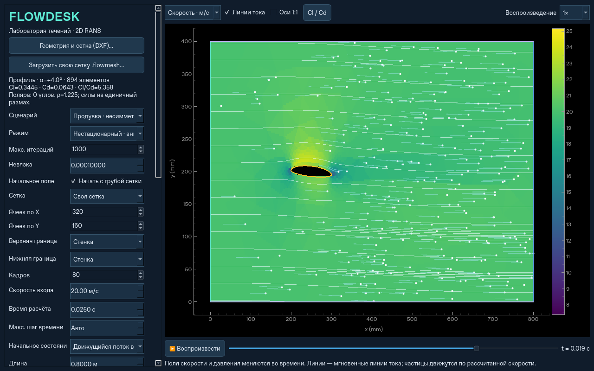

# Развитие течения во времени

В режиме «Нестационарный · анимация полей» рассчитываются и сохраняются
последовательные поля скорости, статического давления относительно эталона,
k и epsilon. Время на ползунке — физическое, а скорость проигрывателя определяет
только темп просмотра. При 1× запись показывается за 8 секунд; между кадрами
поля линейно интерполируются. Сохранение/загрузка NPZ сохраняет всю запись.
Стационарные результаты прежних версий остаются стационарными при открытии.

Для своей сетки и эллиптического профиля используется URANS на исходных ячейках:

- Backward Euler для производных u/v/k/epsilon по времени.
- Неявные перенос (upwind) и диффузия с неортогональной поправкой FiPy.
- Внутренние итерации SIMPLE/Rhie–Chow при фиксированных старых физических полях.
- Сходимость каждого шага контролируется невязками импульса, k, epsilon и
  неразрывности. Три последовательные успешные проверки принимают шаг.
  При исчерпании лимита расчёт останавливается с полным отчётом; несошедшиеся
  итерации не превращаются в кадры физического времени.
- По умолчанию начальное состояние — однородный движущийся поток с проекцией
  скорости на дискретную неразрывность и непроницаемость тела. Затем развиваются
  пограничный слой и след. Для своей сетки и профиля доступен также «Пуск из покоя»:
  входная скорость включается при t=0+. Начальное давление принимается нулевым. В несжимаемой модели пуск создаёт импульс
  давления: первый ненулевой кадр может иметь намного больший диапазон давления,
  чем последующие. Уменьшение шага позволяет изучать этот переход подробнее.
- Автоматический шаг не превышает интервал сохраняемых кадров и 0.2 Lref/U;
  Lref — хорда профиля или меньший размер импортированной области. Длинные
  интервалы кадров разбиваются на равные шаги. Поле «Макс. шаг времени» дополнительно
  ограничивает шаг. Это временной масштаб для предварительного просмотра,
  а не гарантия разрешения всех ячеек по CFL. Фактические dt, число Куранта,
  невязки и баланс расхода каждого шага сохраняются в `diagnostics.time_history`.

Для встроенных прямоугольных сценариев сохранена явная MAC-проекция с
автоматическим ограничением по CFL и диффузии; ограничение шага также действует.

Белые линии — мгновенные линии тока. Частицы со шлейфами в нестационарном режиме
интегрируются методом RK2 в пространстве и времени по сохранённой растровой
записи скорости, с шагом перемещения до 0.45 пикселя. На выходе/стенке частица
пересоздаётся без соединительного шлейфа. Перемотка и переход на начало записи
сбрасывают траектории. Это пассивная визуализация, без массы и обратного влияния
на жидкость; точность траекторий ограничена разрешением сохраняемой записи.

Для профиля доступны графики Cl(t), Cd(t), Cl/Cd(t) и CSV с колонкой `time`.
Поляра по углу относится к стационарному режиму и не смешивается с пусковыми
коэффициентами. Экспорт VTU содержит итоговое поле на реальных элементах,
NPZ — дополнительно всю временную запись отображаемых полей.

Стандартная k–epsilon описывает осреднённую турбулентность. URANS может показать
нестационарный средний поток, но не воспроизводит все мелкие турбулентные вихри.
Результат может установиться при постоянных границах. Вихри для красоты не
добавляются. Первый порядок upwind/Backward Euler даёт численную диффузию;
для исследования следа требуются сгущение сетки и проверка уменьшением dt.
Точность ±10% для временных коэффициентов профиля пока не подтверждена.

Проверки в `tests/test_transient_native.py`: аналитическое затухание синусоидальной
моды диффузии с уменьшением dt вдвое, разные физические кадры и баланс массы на
обеих сетках с препятствием, история сил по времени, CSV/NPZ и движение трассеров
на заданное расстояние в однородном потоке.

[Пример анимации](profile-animation.gif) получен из фактического расчёта профиля:
894 треугольника, 80 кадров, t=0…0.025 с, U=20 м/с.
Максимальный небаланс расхода по шагам — 1.40e−14; итоговый Cl=0.34452, Cd=0.06430.
Это проверка работоспособности и сохранения массы; экспериментальная точность
из этих чисел не следует. [Численный отчёт](transient-validation.json).
